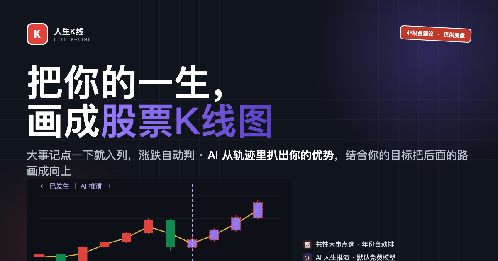

# WorkBuddy「1024 造物挑战」参赛作品集

> 9 款纯本地、零依赖、打开即用的小应用。全部在 WorkBuddy 中开发。
> 活动：https://www.workbuddy.link/p/8QYARuAmZ9RgQty3FSzNUs



## 作品清单

| # | 作品 | 一句话 | 链接 |
|---|------|--------|------|
| 04 | **人生K线** | 把你的一生画成股票K线图：大事点选入列、涨跌自动判、AI 从轨迹提炼优势并结合你的目标画一段向上的路。不是算命，是规划引导。 | [打开](https://meme-foundry.app.workbuddy.host/?sharecode=LSI4UGGKBW) · [镜像](https://rov639.github.io/wb1024-challenge/04-life-kline/) |
| 02 | **截图缝合师** | 几张截图变一张长图：相邻重复部分自动消重，顺序传反了也能缝。全程本地，截图零上传。 | [打开](https://rov639.github.io/wb1024-challenge/02-shot-stitcher/) |

> 更多作品开发中。技术约定：单文件 HTML / 原生 JS + Canvas / 零外部依赖（AI 功能走 WorkBuddy 云服务免密钥接口，默认免费模型）。

## 目录

```
01-meme-foundry/   （已弃选归档）
02-shot-stitcher/  截图缝合师
04-life-kline/     人生K线（cover.html 为封面源文件）
```
